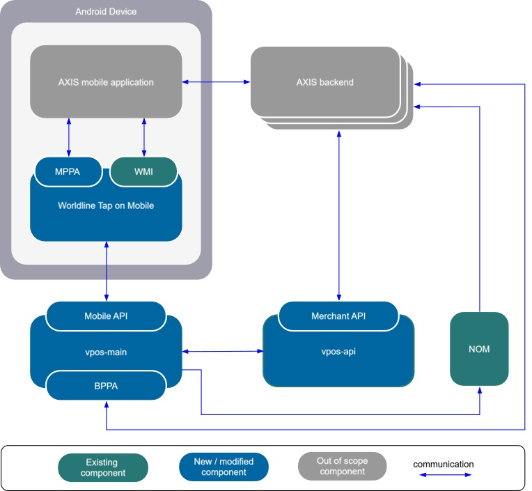
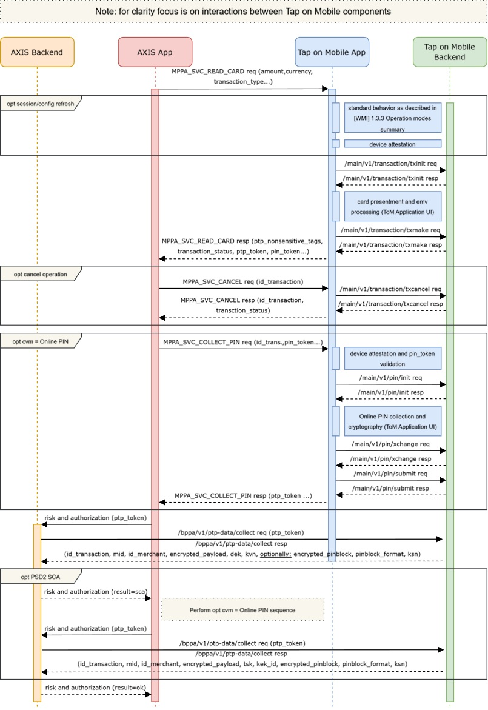

# 6 Mobile Pass-Through Processing 
## 6.1	Description of the solution
[BACK](../5_Tap_on_Mobile_backend_API/5_Tap_on_Mobile_backend_API.md)

A new acquirer will be created for PTP integration, and all required card brands will be configured for it. These brands will also be enabled on PTP terminal profiles. Some parameters such as supported brands, transaction types and limits will be configured on a merchant level. This configuration will limit terminal configuration assigned to it by terminal profile.

The ToM Application's operations with the PTP acquirer will be limited to integrated mode only - registration will be possible using WMI and a dedicated registration package name.

A new transaction-processing flow will be implemented through dedicated APIs (MPPA and BPPA). In this flow ToM Backend does not offer authorization and clearing functions. The transaction EMV data and, optionally, the transaction PIN block can be retrieved directly from the ToM Backend in encrypted form.

Overall setup is illustrated in a diagram below:

Card processing in pass-through mode will be possible with a new dedicated intent API – MPPA by calling MPPA_SVC_READ_CARD intent.

On request, ToM application will verify whether login is required and perform it if needed. Then transaction will be initialized and ToM ‘approach card’ screen will be displayed. After card is read, kernel processing result will be sent to ToM backend. Based on the kernel data, mobile application set pin request flag and vpos-main will set appropriate transaction status (PIN_REQUESTED if pin is required by kernel or PTP_READ if pin is not required). Response, together with pin token, ptp token, transaction status and non-sensitive data will be sent back to calling application. PIN token is mandatory for pin collection initialization while the PTP token is mandatory for collecting transaction data from BPPA.

If PIN is required, PTP mobile application must call MPPA_SVC_COLLECT_PIN intent to initialize pin collection. ToM application will display pin collection screen and send collected pinblock to ToM backend where it will be stored for further processing. As amount and currency are mandatory during pin collection they must be passed in request – cardholder amount and currency must be provided for transactions with DCC.

If, for some reason, transaction cannot be continued, it must be interrupted by PTP mobile application by calling MPPA_SVC_CANCEL intent. This will trigger deletion of transaction sensitive data on ToM backend.

Transaction data can be collected by PTP backend by calling BPPA endpoint. API will return transaction data if those data have been collected properly. Pin data in response are optional and will be present in response only if PIN has been collected. It is not possible to obtain only partial transaction data; therefore, if PIN is collected after SCA or during a PIN retry procedure, another BPPA collect call will return the full data set.

Described processing is presented on the diagram below:

[NEXT](./6_2_Interface_structure_and_activity_launch.md)
