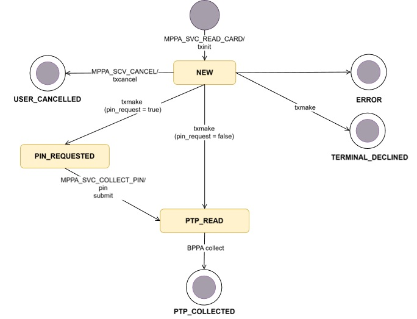

[BACK](./6_6_BPPA_interface.md)

## 6.6 PTP transaction statuses
Diagram below presents transaction statuses in pass-through processing mode.

Table presented below contains transaction statuses that may occur during PTP processing.
|STATUS|DESCRIPTION|
|---------|-----------|
|CANCELLED|Previously authorized transaction reverted/cancelled by CANCEL_TRANSACTION|
|REJECTED|Transaction was rejected after initiation (i.e. by other overlaying application)|
|TERMINAL_DECLINED|Transaction was declined by terminal (ie. Kernel declined because of expiry date, card not fully read or not recognized)|
|USER_CANCELLED|Transaction is cancelled by user on terminal screen|
|ERROR|Technical status: indicating problems while transaction processing|
|PIN_REQUESTED|Technical status: Application couldn’t handle PIN or couldn’t connect to PIN process|
|NEW|Technical status: transaction was initiated, but it was interrupted at fist stage or process|
|PTP_READ|Status related to PTP. Card data has been collected and can be shared with integrator|
|PTP_COLLECTED|Status related to PTP. Transaction finished – card data collected by integrator.|

[NEXT](./6_8_MPPA_error_codes.md.md)
